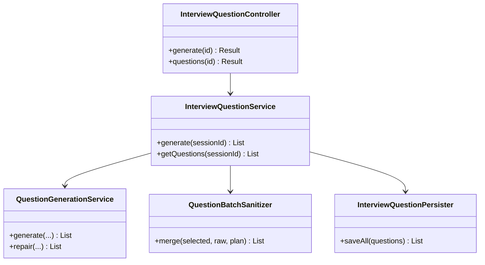

# M4-3：让 AI 按清单出题

> **本课假设你**：会写 Java 基本语法（类、方法、if/for、泛型大概认识）。
>
> **本课不假设你**：懂 AI 调用、提示词、JSON、结构化输出、数据库事务、幂等、单元测试、并发。
> 这些词第一次出现时都会解释。如果任何一行代码你看不懂，直接问，不要往下抄。

---

# 第 0 部分：先搞清楚这一课在做什么

## 0.1 用生活场景说一遍

假设你要办一场模拟面试。上一课（M4-2）你其实只做了一件事：

> **定好了一张"考卷结构单"**，并且把它存进了数据库。

这张单子长这样：

```
方向：Java 后端
难度：困难
总题数：10
分配：Java 3 道、MySQL 2 道、Redis 2 道、Spring 2 道、项目经历 1 道
```

**但单子上还没有题。** 单子只是说"要 3 道 Java 题"，并没有说那 3 道题是什么。

这一课要做的事，一句话：

> 拿着这张单子，去问一个"出题老师"（AI），让他把 10 道题真的写出来，然后存进数据库。

## 0.2 这件事里会出现 5 个"角色"

下面每个角色最后都会变成一个 Java 类。现在先把它们当成人：

| 角色 | 干什么 | 后面会写成 |
|---|---|---|
| **接待员** | 有人来了，收下要求，转给后厨 | `InterviewQuestionController` |
| **主厨** | 决定做事的顺序：查单子 → 请老师 → 让校对检查 → 存档 | `InterviewQuestionService` |
| **出卷老师** | 真的去问 AI | `QuestionGenerationService` |
| **校对员** | 检查 AI 交回来的东西能不能用 | `QuestionBatchSanitizer` |
| **档案员** | 把题写进数据库 | `InterviewQuestionPersister` |

你可能会想：**为什么不能一个类干完？我写一个类不就行了？**

这个问题非常好，第 3 部分专门回答。现在先记住：**因为 AI 不可靠，所以"问 AI"和"检查 AI"必须能分开。**

## 0.3 整体流程（人话版）

```
前端说："给第 1 场面试出题"
        │
        ▼
接待员收下  ────────────────────────────────┐
        │                                   │
        ▼                                   │
主厨开始干活：                               │
  ① 查这场面试的结构单（10 道，怎么分配）      │
  ② 查数据库：这场面试是不是已经有题了？        │
        │                                   │
        ├── 已经有 → 直接交出去（不再问 AI）    │ ← 这叫做"幂等"
        │                                   │
        └── 没有 → 继续                        │
                │                           │
                ▼                           │
        ③ 请出卷老师（AI）出题                  │
          告诉老师：人设规则 + 分配单 + 难度 + 简历  │
                │                           │
                ▼                           │
          AI 回来一段文字（JSON 格式）           │
                │                           │
                ▼                           │
        ④ 交给校对员检查                       │
          丢掉编造的分类                         │
          丢掉重复的题                           │
          超过配额的砍掉                         │
                │                           │
                ▼                           │
        ⑤ 数一数：够 10 道吗？                  │
                │                           │
                ├── 不够 → 记住缺哪几道，再找老师补（最多 2 次）
                │                           │
                └── 够了 → 继续                 │
                        │                    │
                        ▼                    │
                ⑥ 交给档案员，一次性写进数据库      │
                        │                    │
                        ▼                    │
                  返回给前端 10 道题 ───────────┘
```

**这张图里最不直观的一步是"④ 校对"。** 大部分人第一反应是："AI 都给答案了，直接存不就行了？"

不行。原因第 2 部分会详细讲 —— 简单说：**AI 很聪明，但它不听话。**

## 0.4 类地图：每个类里到底有什么

上一小节的流程图回答的是"**先后顺序**"。这一小节回答的是"**写几个类、每个类里放什么**"。

规则很简单，记住这两条就够了：

- **业务类 → 看方法**（它会被调用什么）
- **模型类 → 看字段**（它装什么数据）

### 0.4.1 依赖方向

箭头表示"调用"。被箭头指向的类，**不知道**调用它的类存在。



**怎么读这张图**：

- `InterviewQuestionController` 只知道 `InterviewQuestionService`
- `QuestionBatchSanitizer` 谁都不认识，**只认识模型类** —— 这就是它能被单独测试的原因
- `QuestionGenerationService` 也不知道数据库存在 —— 这就是以后能换 AI 厂商的原因

### 0.4.2 业务类（只列方法）

**`InterviewQuestionController`** —— 接待员

| 方法 | 入参 | 返回 | 一句话 |
|---|---|---|---|
| `generate` | `Long id` | `Result<List<QuestionResponse>>` | 出题，对外入口 |
| `questions` | `Long id` | `Result<List<QuestionResponse>>` | 查题目，对外入口 |

**`InterviewQuestionService`** —— 主厨（本课最核心的类）

| 方法 | 访问 | 入参 | 返回 | 一句话 |
|---|---|---|---|---|
| `generate` | public | `Long sessionId` | `List<QuestionResponse>` | 幂等 → 出题 → 校对 → 补题 → 落库 |
| `getQuestions` | public | `Long sessionId` | `List<QuestionResponse>` | 只读查询 |
| `loadSession` | private | `Long sessionId` | `InterviewSessionEntity` | 查会话，查不到抛 3002 |
| `findMissing` | private | `plan`, `selected` | `List<MissingQuota>` | 数一数每个分类还差几道 |
| `buildEntities` | private | `sessionId`, `collected`, `difficulty` | `List<InterviewQuestionEntity>` | 把题变成要写库的行 |
| `buildResumeSection` | private | `Long resumeId` | `String` | 把简历转成提示词片段，超长截断 |
| `questionLines` | private | `List<GeneratedQuestion>` | `String` | 把已出的题排成给 AI 看的清单 |
| `toResponses` | private | `entities`, `plan` | `List<QuestionResponse>` | 实体 → DTO（丢掉答案要点） |
| `parsePlan` | private | `String json` | `List<CategoryQuota>` | 把 `plan_json` 解析回对象 |
| `toJson` | private | `List<String>` | `String` | 把答案要点序列化成字符串 |

> 为什么全是 private？因为它们只是"主厨的内部步骤"。**外部只能看到 `generate` 和 `getQuestions` 这两个门**，中间怎么切菜是它自己的事。

**`QuestionGenerationService`** —— 出卷老师

| 方法 | 访问 | 入参 | 返回 | 一句话 |
|---|---|---|---|---|
| `generate` | public | `systemPrompt`, `skillName`, `difficulty`, `totalQuestions`, `plan`, `resumeSection` | `List<GeneratedQuestion>` | 首轮一次性要全部题 |
| `repair` | public | `systemPrompt`, `skillName`, `difficulty`, `missing`, `existingQuestions`, `resumeSection` | `List<GeneratedQuestion>` | 只补缺口 |
| `quotaLines` | private | `List<CategoryQuota>` | `String` | 配额 → 提示词里的一行行字 |
| `missingLines` | private | `List<MissingQuota>` | `String` | 缺口 → 提示词里的一行行字 |
| `difficultyHint` | private | `InterviewDifficulty` | `String` | `HARD` → "聚焦边界条件…" |
| `load` | private static | `resourceLoader`, `location` | `String` | 启动时把模板读进内存 |

**`QuestionBatchSanitizer`** —— 校对员

| 方法 | 访问 | 入参 | 返回 | 一句话 |
|---|---|---|---|---|
| `merge` | public | `selected`, `raw`, `plan` | `List<GeneratedQuestion>` | 合并 + 归一化 + 去重 + 截断 |
| `capExpectedPoints` | private | `List<String>` | `List<String>` | 答案要点最多留 5 条 |
| `normalizeKey` | private | `String` | `String` | 分类名转大写、去空白 |
| `normalizeText` | private | `String` | `String` | 题目文字去掉标点空白，用来判重 |

**`InterviewQuestionPersister`** —— 档案员

| 方法 | 访问 | 入参 | 返回 | 一句话 |
|---|---|---|---|---|
| `saveAllQuestions` | public | `List<InterviewQuestionEntity>` | `List<InterviewQuestionEntity>` | 一个事务里批量写入 |

**`DevQuestionController`** —— 临时调试用，第 3 步删除

| 方法 | 入参 | 返回 | 一句话 |
|---|---|---|---|
| `rawGenerate` | `Long id` | `Result<List<GeneratedQuestion>>` | 不校对、不落库，直接看 AI 原始输出 |

### 0.4.3 模型类（只列字段）

**`GeneratedQuestion`** —— AI 返回的一道题（record）

| 字段 | 类型 | 含义 |
|---|---|---|
| `categoryKey` | `String` | 分类标识，如 `"JAVA"` |
| `question` | `String` | 题目正文 |
| `expectedPoints` | `List<String>` | 参考答案要点 3–5 条 |

**`GeneratedQuestionBatch`** —— AI 返回的整体（record）

| 字段 | 类型 | 含义 |
|---|---|---|
| `questions` | `List<GeneratedQuestion>` | 一次返回的所有题 |

**`MissingQuota`** —— 缺口（record）

| 字段 | 类型 | 含义 |
|---|---|---|
| `categoryKey` | `String` | 哪个分类 |
| `label` | `String` | 分类中文名（拼提示词用） |
| `need` | `int` | 还差几道 |

**`QuestionResponse`** —— 返回给前端（record）

| 字段 | 类型 | 含义 |
|---|---|---|
| `questionId` | `Long` | 数据库主键 |
| `questionIndex` | `int` | 第几题，从 0 开始 |
| `categoryKey` | `String` | 分类标识 |
| `categoryLabel` | `String` | 分类中文名（前端直接显示） |
| `difficulty` | `String` | 难度 |
| `questionText` | `String` | 题目正文 |

> **注意这里没有 `expectedPoints`。** 不是漏写 —— 模型类里"有什么字段"本身就是一种设计决策，这个决策叫"别泄题"。

### 0.4.4 资源文件（提示词模板）

| 文件 | 占位符（写代码时必须是这些名字） |
|---|---|
| `interview-question-user.st` | `{skillName}` `{difficulty}` `{difficultyHint}` `{totalQuestions}` `{quotaLines}` `{resumeSection}` |
| `interview-question-repair-user.st` | `{skillName}` `{difficulty}` `{resumeSection}` `{existingQuestions}` `{missingLines}` |

**占位符名字必须和 Java 里 `variables.put("xxx", ...)` 的 key 完全一致**（大小写敏感）。不一致的后果很隐蔽：模板里那个位置会变成**空白**，AI 收到的提示词缺一段，你会觉得"AI 怎么不听要求"。

### 0.4.5 为什么"业务类看方法、模型类看字段"

因为它们回答的是两个不同的问题：

| 类 | 回答的问题 | 所以看 | 它有状态吗 |
|---|---|---|---|
| 业务类 | "它能干什么？" | 方法 | 除了注入的依赖，没有可变状态 |
| 模型类 | "它装什么？" | 字段 | 全部都是状态，没有行为 |

这个划分有个名字叫**"数据与行为分离"**。好处很实际：

- 模型类全是字段 → 一眼就能看出接口返回什么、数据库存什么
- 业务类全是方法 → 一眼就能看出系统的能力清单

反例是那种"既存数据又干活"的类（比如一个 `Session` 类里带 `generateQuestions()` 方法）。这种类一旦需要测试，就得先造出完整数据，很难测。

## 0.5 这一课分 3 步做

一次性写 12 个文件，你根本不知道哪一步出了问题。所以拆成 3 步，**每步做完都能看到结果**：

| 步骤 | 做什么 | 做完你能看到什么 |
|---|---|---|
| **第 1 步** | 让 AI 出一次题，把原始结果打印出来 | 一个接口返回 10 道题（但很可能是乱的） |
| **第 2 步** | 加"校对员"，把乱的结果变干净 | 单元测试通过，跑 8 个检查 |
| **第 3 步** | 存档 + 正式接口 + 补题 | 数据库里出现 10 行题目 |

**第 1 步故意不写校对**，因为你需要**先亲眼看到 AI 有多不靠谱**，才会明白校对员为什么存在。

---

# 第 1 步：让 AI 出一次题，看看它到底返回什么

## 1.1 先建立 4 个最基本的概念

### 概念 A：程序"调 AI"是什么意思

你在网页上用 ChatGPT 时，发生的是这样的事：

```
你打字："帮我写一句下雨的文案"
   ↓ 这段文字通过网络发到 OpenAI/DeepSeek 的服务器
模型返回："雨落下来的时候，世界安静了一点点"
   ↓ 显示在你屏幕上
```

**程序调 AI，就是用代码代替你打字**：代码把一段文字发到服务器，再把服务器返回的文字收下来。

关键在于：**AI 只会回一段文字。** 它不知道你的数据库里有什么，不知道你定了几道题。所以你想让它按你的要求出题，**必须把要求全部写在那段文字里**。

### 概念 B：什么是"提示词"（prompt）

**提示词就是"你发给 AI 的那段文字"。**

本项目的提示词由两部分拼起来：

| 部分 | 内容 | 什么时候变 |
|---|---|---|
| **system（系统提示词）** | "你是一位 Java 后端面试官，目标是判断候选人…" 这类**身份和规则** | 基本不变 |
| **user（用户提示词）** | "这次出 10 道题，Java 3 道、MySQL 2 道…难度困难" | 每次都变 |

为什么分两部分？第 3 部分讲。

我们项目里，`system` 用的是 `skills/java-backend/SKILL.md` 的正文（就是你 M4-1 写的那个 Markdown 文件 —— 它现在从"展示信息"变成了"给 AI 的指令"），`user` 用的是新建的模板文件。

### 概念 C：什么是 JSON，为什么需要它

假设 AI 返回这样一段文字：

```
好的，以下是为您准备的 10 道题：
1. HashMap 的扩容机制是什么？
2. MySQL 索引为什么用 B+ 树？
...
```

这段文字**人能读，程序没法用**。你的程序没法自动判断"第 1 题属于哪个分类"、"题目从第几个字符开始"。

所以我们要让 AI 返回一种**固定格式**的文本，叫 JSON：

```json
{
  "questions": [
    { "categoryKey": "JAVA", "question": "HashMap 的扩容机制是什么？", "expectedPoints": ["…", "…"] },
    { "categoryKey": "MYSQL", "question": "MySQL 索引为什么用 B+ 树？", "expectedPoints": ["…"] }
  ]
}
```

JSON 的规则只有几条：

- `{ }` 表示"一个对象"，里面是 `"键": 值` 的列表
- `[ ]` 表示"一个列表"，可以装很多个东西
- 键和值之间用冒号，条目之间用逗号
- 字符串要加双引号

你就把它想成**一张填好的表格**。程序读 JSON，就像读表格的某一列。

### 概念 D：什么是"结构化输出"，为什么它也可能失败

"让 AI 返回 JSON"有个专有名词叫**结构化输出**。

问题在于：**AI 是"语言模型"，它的本职是生成像人话的文字，不是严格遵守格式。**

你让它返回 JSON，它大部分时候会照做，但有时候会：

- 在 JSON 前面加一句"好的，以下是题目："
- 少给几道题（要 10 道给 8 道）
- 把 `"JAVA"` 写成 `"Java基础"`
- 同一道题换个说法出两遍
- 返回的 JSON 少一个括号，解析直接失败

**这就是为什么第 2 步必须有"校对员"。** 不是我们多此一举，是 AI 真的会这样。

Spring AI 提供了一个方法 `.entity(Xxx.class)`，它会：
1. 把你要的 Java 类（比如 `GeneratedQuestionBatch`）翻译成一份"格式要求说明"
2. 把这份说明塞进提示词
3. 拿到 AI 返回的文字后，自动转成 Java 对象

**但它只能保证"格式像"，不能保证"内容对"。** 数量对不对、分类对不对、有没有重复 —— 全靠你自己检查。

## 1.2 先写两个"文件"

### 文件 1：`src/main/resources/prompts/interview-question-user.st`

这是一个**纯文本文件**（后缀 `.st` 只是个约定）。内容是发给 AI 的"本次任务说明"。

```
现在开始为一场「{skillName}」模拟面试出题。

面试难度：{difficulty}
题目总数：{totalQuestions}

各分类配额（必须严格遵守，不要多也不要少）：
{quotaLines}

{resumeSection}

出题要求：
1. 每道题只考察一个知识点，问题本身要具体、可作答；
2. 避免「谈谈你对某技术的理解」这类空泛提问，尽量给出场景、约束条件或数据量级；
3. 同一分类内部不得出现重复或高度相似的问题；
4. 难度定位：{difficultyHint}
5. 只输出题目，不要输出答案正文；每道题给出 3 到 5 条 expectedPoints 作为参考答案要点；
6. categoryKey 必须严格使用上面列出的分类标识，不要自创分类。
```

**这是什么**：一份带"空格"的纸条。

**怎么用**：程序运行时，把 `{skillName}` `{quotaLines}` 这些空格填上真实内容，再发给 AI。填完大概长这样：

```
现在开始为一场「Java 后端开发」模拟面试出题。

面试难度：HARD
题目总数：10

各分类配额（必须严格遵守，不要多也不要少）：
- JAVA（Java）：3 道
- MYSQL（MySQL）：2 道
- REDIS（Redis）：2 道
- SPRING（Spring）：2 道
- PROJECT（项目经历）：1 道

出题要求：
1. 每道题只考察一个知识点…
```

**为什么这么写**：

- "每道题只考察一个知识点" —— 不然它会出一道"讲讲 Java 内存模型和 GC，以及你怎么排查 OOM"这种大杂烩
- "避免谈谈你对某技术的理解" —— 这类问题没有标准答案，也没法评分
- "3 到 5 条 expectedPoints" —— 这是**参考答案要点**，第 3 步打分时要用
- "categoryKey 必须严格使用" —— 不然它会自己发明分类名，你后面按分类统计就全乱了

⚠️ **一个必须知道的限制**：这个模板**不能出现英文花括号 `{` `}`（除了占位符本身），也不能出现 `<` `>`**。

原因：Spring AI 渲染这个模板时用的不是"简单字符串替换"，而是一个真正的**模板引擎**（叫 StringTemplate）。它会把任何 `{...}` 当成"要计算的表达式"。

所以如果你在提示词里写了一个 JSON 例子：

```
请按这个格式返回：{"questions":[...]}
```

模板引擎会试图计算 `"questions"` 这个表达式 → **报错，或者更糟：悄悄渲染成空白**，你的提示词默默少了一段，AI 输出变得莫名其妙。

**本项目的规避办法**：干脆不在提示词里写任何 JSON 例子。因为 `.entity()` 会自动把格式要求注入进去，我们不需要手写。

### 文件 2：两个 Java record

路径：`src/main/java/com/interviewmind/modules/interview/model/GeneratedQuestion.java`

```java
package com.interviewmind.modules.interview.model;

import java.util.List;

/**
 * AI 生成的一道题。
 * 这里的字段名，必须和提示词里要求的 JSON 字段名一致，改名会让解析失败。
 */
public record GeneratedQuestion(
        String categoryKey,
        String question,
        List<String> expectedPoints) {
}
```

路径：`src/main/java/com/interviewmind/modules/interview/model/GeneratedQuestionBatch.java`

```java
package com.interviewmind.modules.interview.model;

import com.interviewmind.modules.interview.model.AIresult.GeneratedQuestion;

import java.util.List;

/**
 * 外面多包一层：{ "questions": [ ... ] }
 * 好处是以后要加"本次说明"之类整体字段时，不用改接口格式。
 */
public record GeneratedQuestionBatch(List<GeneratedQuestion> questions) {
}
```

**这是什么**：`record` 是 Java 14 以后的一种"只装数据的小类"。一行 `record Xxx(字段1, 字段2)` 就自动帮你生成构造器、getter、`equals`。

**为什么用 record 而不是普通类**：因为这两个类**只用来接 AI 返回的数据**，没有任何逻辑。record 最省事。

**为什么外面要包一层 `GeneratedQuestionBatch`**：

直接要 `List<GeneratedQuestion>` 行不行？技术上可以，但外层包一个对象更稳：

- 如果 AI 只返回一个数组 `[...]`，有些解析器会不适应；包一层 `{ "questions": [...] }` 更明确
- 以后想加"本次生成的说明""模型的置信度"这类**整体信息**，直接在 batch 里加字段，不用改外面

> 注意：这里的 record **能**被自动填充，是因为我们用的是 Jackson（Spring AI 内部的 JSON 库），它支持 record 的构造器绑定。
>
> 但 M4-1 那个 `SkillDefinition` 就必须用普通类 —— 因为读 YAML 用的是另一个库（SnakeYAML），它只认"无参构造器 + setter"。**两个库、两套规矩**，别混。

## 1.3 写"出卷老师"：`QuestionGenerationService`

路径：`src/main/java/com/interviewmind/modules/interview/service/QuestionGenerationService.java`

```java
package com.interviewmind.modules.interview.service;

import com.interviewmind.common.exception.BusinessException;
import com.interviewmind.common.exception.ErrorCode;
import com.interviewmind.modules.interview.model.backendModel.CategoryQuota;
import com.interviewmind.modules.interview.model.AIresult.GeneratedQuestion;
import com.interviewmind.modules.interview.model.AIresult.GeneratedQuestionBatch;
import com.interviewmind.modules.interview.model.status.InterviewDifficulty;
import lombok.extern.slf4j.Slf4j;
import org.springframework.ai.chat.client.ChatClient;
import org.springframework.ai.chat.prompt.PromptTemplate;
import org.springframework.core.io.ResourceLoader;
import org.springframework.stereotype.Service;

import java.io.IOException;
import java.nio.charset.StandardCharsets;
import java.util.HashMap;
import java.util.List;
import java.util.Map;
import java.util.stream.Collectors;

@Slf4j
@Service
public class QuestionGenerationService {

    private final ChatClient chatClient;
    private final PromptTemplate generateTemplate;

    public QuestionGenerationService(ChatClient chatClient, ResourceLoader resourceLoader) throws IOException {
        this.chatClient = chatClient;
        this.generateTemplate = new PromptTemplate(
                load(resourceLoader, "classpath:prompts/interview-question-user.st"));
    }

    private static String load(ResourceLoader resourceLoader, String location) throws IOException {
        return resourceLoader.getResource(location).getContentAsString(StandardCharsets.UTF_8);
    }

    /** 拿着一份配额单，请 AI 出题，返回它给的原始结果（还没校对） */
    public List<GeneratedQuestion> generate(String systemPrompt,
                                            String skillName,
                                            InterviewDifficulty difficulty,
                                            int totalQuestions,
                                            List<CategoryQuota> plan,
                                            String resumeSection) {

        // ① 准备好要往模板空格里填的东西
        Map<String, Object> variables = new HashMap<>();
        variables.put("skillName", skillName);
        variables.put("difficulty", difficulty.name());
        variables.put("difficultyHint", difficultyHint(difficulty));
        variables.put("totalQuestions", totalQuestions);
        variables.put("quotaLines", quotaLines(plan));
        variables.put("resumeSection", resumeSection == null ? "" : resumeSection);

        // ② 填空，得到最终要发出去的文字
        String userText = generateTemplate.render(variables);

        // ③ 发出去，把回来的文字转成 Java 对象
        try {
            GeneratedQuestionBatch batch = chatClient.prompt()
                    .system(systemPrompt)      // 人设和规则
                    .user(userText)            // 本次任务
                    .call()                    // 真正发出网络请求
                    .entity(GeneratedQuestionBatch.class);   // 自动转成 Java 对象

            if (batch == null || batch.questions() == null || batch.questions().isEmpty()) {
                throw new BusinessException(ErrorCode.INTERVIEW_QUESTION_GENERATION_FAILED,
                        "AI 未返回任何题目");
            }
            log.info("AI 出题完成，返回 {} 道题", batch.questions().size());
            return batch.questions();

        } catch (BusinessException e) {
            throw e;
        } catch (Exception e) {
            log.error("AI 出题失败", e);
            throw new BusinessException(ErrorCode.INTERVIEW_QUESTION_GENERATION_FAILED,
                    "AI 出题失败：" + e.getMessage(), e);
        }
    }

    /** 把配额翻译成给人看的一行行文字 */
    private String quotaLines(List<CategoryQuota> plan) {
        return plan.stream()
                .filter(quota -> quota.quota() > 0)
                .map(quota -> "- " + quota.categoryKey() + "（" + quota.label() + "）：" + quota.quota() + " 道")
                .collect(Collectors.joining("\n"));
    }

    /** 把"困难"翻译成一句给 AI 看的具体说明 */
    private String difficultyHint(com.interviewmind.modules.interview.model.status.InterviewDifficulty difficulty) {
        return switch (difficulty) {
            case EASY -> "偏基础，考察概念准确性与常见用法";
            case MEDIUM -> "中等，兼顾原理机制与真实工程场景";
            case HARD -> "偏难，聚焦边界条件、故障排查与设计取舍";
        };
    }
}
```

### 这段代码逐块解释

**① 构造器在干什么**

```java
public QuestionGenerationService(ChatClient chatClient, ResourceLoader resourceLoader)
```

- `ChatClient`：Spring AI 提供的"打电话给 AI 的工具"。**这是什么** —— 可以理解成一个已经拨好号、配好密钥的"电话"，你只需要说内容。它在 M2 的 `AiConfig` 里已经配好了，全项目共用。
- `ResourceLoader`：Spring 提供的"读文件工具"，能从 `src/main/resources` 下按路径读文件。
- 构造器里做了一件事：**启动时把提示词模板读进内存，只读一次**。为什么？因为读文件是慢操作，没必要每次调 AI 都读一遍。

**② `variables` 这个 Map 在干什么**

模板里有 `{skillName}` 这样的占位符，`render(variables)` 会去 Map 里找 `skillName` 这个键的值填进去。

**为什么用 Map 而不是一串参数**：因为模板引擎只认 `Map<String, Object>`，它不知道你有几个参数。

**③ `.system()` / `.user()` / `.call()` / `.entity()` 分别是什么**

| 方法 | 作用 | 生活类比 |
|---|---|---|
| `.system(文字)` | 设置 AI 的"身份" | 告诉员工"你是面试官" |
| `.user(文字)` | 本次的具体任务 | 给员工一张今天的活单 |
| `.call()` | 真正发网络请求 | 员工开始干活（这一步要等十几秒） |
| `.entity(类)` | 把回来的文字转成 Java 对象 | 把员工交回的报告录入系统 |

**④ `quotaLines` 为什么要过滤 `quota() > 0`**

第 2 课有个情况：只出 1 道题时，配额是 `Java 0, MySQL 0, …, 项目经历 1`。

如果不过滤，提示词里会出现"Java：0 道"，模型可能真的给你出一道 Java 题（它觉得 0 也得给一道）。**跟 AI 说话要少给它犯迷糊的机会** —— 所以直接不告诉它数量为 0 的分类。

**⑤ `difficultyHint` 为什么要翻译**

`HARD` 这个词 AI 大致能懂，但"偏难"到底多难？给一句具体说明（"聚焦边界条件、故障排查与设计取舍"），出题质量会明显不一样。

这是**提示词工程里最实用的技巧之一**：不要给形容词，给具体的判断标准。

**⑥ `throws IOException` 是怎么回事**

构造器里读文件可能失败（文件不存在、没权限），这种错误是 `IOException`。Spring 在创建这个对象时如果遇到异常，会直接**启动失败**并打印原因 —— 这正是我们想要的（配置错了就别启动）。

## 1.4 加一个临时接口，好让我们亲眼看到结果

**这是一个临时文件，第 3 步会删掉。**

路径：`src/main/java/com/interviewmind/modules/interview/controller/DevQuestionController.java`

```java
package com.interviewmind.modules.interview.controller;

import com.interviewmind.common.result.Result;
import com.interviewmind.modules.interview.model.AIresult.GeneratedQuestion;
import com.interviewmind.modules.interview.model.GeneratedQuestion;
import com.interviewmind.modules.interview.model.status.InterviewDifficulty;
import com.interviewmind.modules.interview.model.response.SessionResponse;
import com.interviewmind.modules.interview.service.InterviewSessionService;
import com.interviewmind.modules.interview.service.QuestionGenerationService;
import com.interviewmind.modules.interview.service.InterviewSkillService;
import lombok.RequiredArgsConstructor;
import org.springframework.web.bind.annotation.PathVariable;
import org.springframework.web.bind.annotation.PostMapping;
import org.springframework.web.bind.annotation.RequestMapping;
import org.springframework.web.bind.annotation.RestController;

import java.util.List;

/**
 * 临时调试接口：只想看看 AI 到底返回什么，不落库、不校对。
 * 做完第 1 步就删掉。
 */
@RestController
@RequestMapping("/api/dev")
@RequiredArgsConstructor
public class DevQuestionController {

    private final InterviewSessionService sessionService;
    private final InterviewSkillService skillService;
    private final QuestionGenerationService generationService;

    @PostMapping("/sessions/{id}/raw-generate")
    public Result<List<GeneratedQuestion>> rawGenerate(@PathVariable("id") Long id) {
        SessionResponse session = sessionService.get(id);
        String systemPrompt = skillService.getSkillBodies(session.skillId());

        List<GeneratedQuestion> raw = generationService.generate(
                systemPrompt,
                session.skillName(),
                InterviewDifficulty.fromCode(session.difficulty()),
                session.totalQuestions(),
                session.plan(),
                "");

        return Result.success(raw);
    }
}
```

**为什么用这个办法**：它复用了已经写好的 `InterviewSessionService.get()`，那个方法返回的 `SessionResponse` 里已经包含 `plan`、`skillName`、`difficulty`、`totalQuestions` —— 我们不用重复写"解析 plan_json"的代码。

**这就是"把数据整理成 DTO 再返回"的额外好处**：同一个数据，接口能用，内部的其他服务也能用。

## 1.5 检查点：跑起来看

### ① 编译并启动

```powershell
.\scripts\run-dev.ps1
```

### ② 建一个会话（如果还没有）

```powershell
curl.exe -s -X POST http://localhost:8080/api/interview/sessions -H "Content-Type: application/json" -d "{\"skillId\":\"java-backend\",\"totalQuestions\":10,\"difficulty\":\"MEDIUM\"}"
```

记下返回的 `sessionId`，下面假设是 `1`。

### ③ 调临时接口（会等 10–40 秒）

```powershell
curl.exe -s -X POST http://localhost:8080/api/dev/sessions/1/raw-generate
```

### ④ 你要看到的

返回一段 JSON，`data` 里是 AI 给的题目列表。**但注意，很可能不完美。** 请重点检查这 4 件事：

| 检查项 | 怎么看 | 大概率会出现的问题 |
|---|---|---|
| 数量 | 数一下有几条 | 可能只有 8 条、9 条 |
| 分类分布 | 数每个 `categoryKey` 出现几次 | 可能 Java 给了 4 条、Redis 只给了 1 条 |
| 有没有自创分类 | 看有没有 `"GO"`、`"Java基础"` 这类 | 偶发 |
| 有没有重复 | 扫一眼题目文字 | 偶发"换个说法问同一个点" |

**这就是第 1 步的全部意义**：你得亲眼看到这些问题，才会理解第 2 步的校对员不是多余的设计。

> 如果 AI 这次表现完美 —— 也正常，它有概率性。多试两次，你大概率能撞到一次不完美的。

### ⑤ 如果报错

| 报错 | 原因 |
|---|---|
| `AI 出题失败` + `Authentication` / `401` | `DEEPSEEK_API_KEY` 没被读到，检查启动日志 |
| `STException` / 提示词解析异常 | 提示词里出现了英文 `{` `}` 或 `<` `>` |
| `entity(...)` 返回 null | 模型没按格式返回，重试一次通常就好 |

---

# 第 2 步：加"校对员"

## 2.1 先理解"校对"到底校什么

AI 交回来的题目可能在哪 4 个方面出问题：

| 问题 | 例子 | 怎么发现 |
|---|---|---|
| **自创分类** | `"categoryKey": "Java基础"`，但我们的分类只叫 `JAVA` | 拿它和配额单比对，不在单子上的丢掉 |
| **重复** | 两道题都是"HashMap 扩容机制"，只是一个带问号一个不带 | 把题目文字"洗干净"后比对 |
| **超量** | Java 配额 3 道，它给了 4 道 | 数一数，多的砍掉 |
| **数量不足** | 总共只给了 8 道 | 数一数，缺的再去补 |

这四个检查里，前三个**能在本地算出来**（不花钱、不需要 AI），所以写成一个专门的类。

第四个"数量不足"需要**再调一次 AI**，所以放到第 3 步。

## 2.2 什么是"纯函数"和"单元测试"

**纯函数**：同样的输入，永远得到同样的输出，而且**不依赖任何外部东西**（不读数据库、不调网络、不读文件）。

校对员的逻辑就适合写成纯函数：给它一批题目，它返回一批干净题目。给它什么，完全不看外面。

**单元测试**：为一段代码写一个"自动检查程序"。

为什么值得写？因为校对逻辑有很多边界情况：
- 空题目怎么办
- 大小写不同的分类怎么办
- 中文问号和没有问号算不算同一题
- 答案要点有 7 条要留几条

这些情况如果靠"打开浏览器点接口"来验证，试一次要几十秒、还要花 AI 的钱。写成单元测试，**1 秒跑完 8 种情况**，而且以后改代码随时能重跑。

## 2.3 写校对员

路径：`src/main/java/com/interviewmind/modules/interview/service/QuestionBatchSanitizer.java`

```java
package com.interviewmind.modules.interview.service;

import com.interviewmind.modules.interview.model.AIresult.GeneratedQuestion;
import com.interviewmind.modules.interview.model.GeneratedQuestion;
import org.springframework.stereotype.Component;

import java.util.ArrayList;
import java.util.HashMap;
import java.util.HashSet;
import java.util.List;
import java.util.Locale;
import java.util.Map;
import java.util.Set;
import java.util.regex.Pattern;

/**
 * 校对员：把 AI 的原始输出洗干净，并合并进"已经选好的题目"里。
 *
 * 干四件事：
 *   1. 丢掉空题、空分类、自创分类
 *   2. 分类标识统一转大写
 *   3. 去掉重复题（也包括和已选题目重复）
 *   4. 每类不超过配额，答案要点最多留 5 条
 */
@Component
public class QuestionBatchSanitizer {

    private static final int MAX_EXPECTED_POINTS = 5;

    /** 判断"两句话是不是同一题"时，忽略这些字符 */
    private static final Pattern NOISE =
            Pattern.compile("[\\s\\p{Punct}，。？！；：、“”‘’（）《》、·…—－]");

    public List<GeneratedQuestion> merge(List<GeneratedQuestion> selected,
                                         List<GeneratedQuestion> raw,
                                         List<com.interviewmind.modules.interview.model.backendModel.CategoryQuota> plan) {

        // 从"已经选好的"开始，返回一个新列表（不改动传进来的那个）
        List<GeneratedQuestion> result = new ArrayList<>(selected == null ? List.of() : selected);

        // 把配额单转成 Map，方便按分类查"最多几道"
        Map<String, Integer> quotas = new HashMap<>();
        for (com.interviewmind.modules.interview.model.backendModel.CategoryQuota quota : plan) {
            quotas.put(quota.categoryKey(), quota.quota());
        }
        if (quotas.isEmpty()) {
            return result;
        }

        // 统计"已经选好的"里面，每个分类各几道、每道题长什么样
        Map<String, Integer> accepted = new HashMap<>();
        Set<String> seen = new HashSet<>();
        for (GeneratedQuestion question : result) {
            accepted.merge(question.categoryKey(), 1, Integer::sum);
            seen.add(normalizeText(question.question()));
        }

        if (raw == null) {
            return result;
        }

        for (GeneratedQuestion question : raw) {
            // 1. 空题目直接跳过
            if (question == null || question.question() == null || question.question().isBlank()) {
                continue;
            }
            // 2. 分类名统一大写；不在配额单上的分类丢掉
            String categoryKey = normalizeKey(question.categoryKey());
            if (categoryKey == null || !quotas.containsKey(categoryKey)) {
                continue;
            }
            // 3. 这个分类已经够了，不再收
            if (accepted.getOrDefault(categoryKey, 0) >= quotas.get(categoryKey)) {
                continue;
            }
            // 4. 重复题丢掉（seen.add 返回 false 表示已经存在）
            String normalized = normalizeText(question.question());
            if (normalized.isEmpty() || !seen.add(normalized)) {
                continue;
            }
            // 5. 收下
            accepted.merge(categoryKey, 1, Integer::sum);
            result.add(new GeneratedQuestion(
                    categoryKey,
                    question.question().trim(),
                    capExpectedPoints(question.expectedPoints())));
        }
        return result;
    }

    /** 答案要点最多留 5 条，空的丢掉 */
    private List<String> capExpectedPoints(List<String> points) {
        if (points == null || points.isEmpty()) {
            return List.of();
        }
        List<String> cleaned = new ArrayList<>();
        for (String point : points) {
            if (point == null || point.isBlank()) {
                continue;
            }
            cleaned.add(point.trim());
            if (cleaned.size() >= MAX_EXPECTED_POINTS) {
                break;
            }
        }
        return List.copyOf(cleaned);
    }

    private String normalizeKey(String key) {
        if (key == null || key.isBlank()) {
            return null;
        }
        return key.trim().toUpperCase(Locale.ROOT);
    }

    /** 把一句话压成"只留汉字和字母数字"的形式，用来判重 */
    private String normalizeText(String text) {
        if (text == null) {
            return "";
        }
        return NOISE.matcher(text.toLowerCase(Locale.ROOT)).replaceAll("");
    }
}
```

### 三个设计点，逐个说

**① 为什么 `normalizeText` 要"洗干净"再比**

`"HashMap 的扩容机制"` 和 `"HashMap的扩容机制？"` —— 字符串不一样，但**是同一道题**。

如果直接比原字符串，就会当成两道题，用户面试时被问两遍同样的问题。

所以我们先把两边都处理成"只剩汉字字母数字"的形式：

```
"HashMap 的扩容机制"  → "hashmap的扩容机制"
"HashMap的扩容机制？" → "hashmap的扩容机制"
                      ↑ 相等，判为重复
```

这个 `NOISE` 正则里的字符，就是我们要扔掉的：空白、英文标点（`\p{Punct}` 是正则里"所有英文标点"的写法）、以及一堆中文标点。

> **为什么不做得更聪明（比如判断"意思是否相似"）？** 因为那需要引入"向量相似度"，成本高、误判率高。"HashMap 扩容"和"HashMap 树化"很像但是两道不同的题，机器判断容易把好的删掉。**字符串级去重能解决 80% 的重复，剩下的靠提示词约束**，这是性价比最高的做法。

**② 为什么超量就"砍掉"而不是"报错重来"**

配额 3 道，AI 给了 4 道。这 4 道题**都可能是好题**，多出来的第 4 道是额外收获。砍掉比推翻重做便宜太多了。

**③ 为什么 `result` 要新建一个列表，而不是直接改传进来的 `selected`**

因为传进来的列表可能是 `List.of(...)` 这种**不可变列表**，往里 `add` 会直接抛异常。

同时"改别人传进来的东西"是很容易埋 bug 的习惯 —— 调用方以为自己的数据没变，实际上被改了。

**规矩：不知道对方传进来的是不是可变的，就自己新建一个。**

## 2.4 写单元测试

路径：`src/test/java/com/interviewmind/modules/interview/service/QuestionBatchSanitizerTest.java`

```java
package com.interviewmind.modules.interview.service;

import com.interviewmind.modules.interview.model.backendModel.CategoryQuota;
import com.interviewmind.modules.interview.model.AIresult.GeneratedQuestion;
import org.junit.jupiter.api.Test;

import java.util.List;

import static org.assertj.core.api.Assertions.assertThat;

class QuestionBatchSanitizerTest {

    // 直接 new，不需要启动 Spring —— 这就是纯函数的好处
    private final QuestionBatchSanitizer sanitizer = new QuestionBatchSanitizer();

    /** 测试用的配额单：Java 2 道，MySQL 1 道 */
    private static List<CategoryQuota> plan() {
        return List.of(
                new CategoryQuota("JAVA", "Java", "CORE", 2),
                new CategoryQuota("MYSQL", "MySQL", "CORE", 1));
    }

    private static GeneratedQuestion q(String categoryKey, String question) {
        return new GeneratedQuestion(categoryKey, question, List.of("要点一"));
    }

    @Test
    void 自创分类会被丢弃() {
        List<GeneratedQuestion> result = sanitizer.merge(List.of(),
                List.of(q("JAVA", "HashMap 扩容机制"), q("GO", "goroutine 调度")),
                plan());

        assertThat(result).hasSize(1);
        assertThat(result.get(0).categoryKey()).isEqualTo("JAVA");
    }

    @Test
    void 超过配额的部分会被截断() {
        List<GeneratedQuestion> result = sanitizer.merge(List.of(),
                List.of(q("JAVA", "题一"), q("JAVA", "题二"), q("JAVA", "题三")),
                plan());

        assertThat(result).hasSize(2);
    }

    @Test
    void 完全相同的问题只保留一条() {
        List<GeneratedQuestion> result = sanitizer.merge(List.of(),
                List.of(q("JAVA", "HashMap 的扩容机制"), q("JAVA", "HashMap 的扩容机制")),
                plan());

        assertThat(result).hasSize(1);
    }

    @Test
    void 只差标点空白的问题也算重复() {
        List<GeneratedQuestion> result = sanitizer.merge(List.of(),
                List.of(q("JAVA", "HashMap 的扩容机制"),
                        q("JAVA", "HashMap的扩容机制？")),
                plan());

        assertThat(result).hasSize(1);
    }

    @Test
    void 与已选题目重复时不会重复加入() {
        List<GeneratedQuestion> selected = List.of(q("JAVA", "HashMap 的扩容机制"));

        List<GeneratedQuestion> result = sanitizer.merge(selected,
                List.of(q("JAVA", "HashMap 的扩容机制"), q("JAVA", "ConcurrentHashMap 的分段锁")),
                plan());

        assertThat(result).hasSize(2);
    }

    @Test
    void 分类标识大小写会被归一化() {
        List<GeneratedQuestion> result = sanitizer.merge(List.of(),
                List.of(q("java", "HashMap 的扩容机制")),
                plan());

        assertThat(result).hasSize(1);
        assertThat(result.get(0).categoryKey()).isEqualTo("JAVA");
    }

    @Test
    void 空题目与空要点会被清洗() {
        List<GeneratedQuestion> result = sanitizer.merge(List.of(),
                List.of(new GeneratedQuestion("JAVA", "   ", List.of("x")),
                        new GeneratedQuestion("JAVA", "HashMap 的扩容机制", null)),
                plan());

        assertThat(result).hasSize(1);
        assertThat(result.get(0).expectedPoints()).isEmpty();
    }

    @Test
    void 答案要点最多保留五条() {
        List<String> points = List.of("1", "2", "3", "4", "5", "6", "7");

        List<GeneratedQuestion> result = sanitizer.merge(List.of(),
                List.of(new GeneratedQuestion("JAVA", "HashMap 的扩容机制", points)),
                plan());

        assertThat(result.get(0).expectedPoints()).hasSize(5);
    }
}
```

**怎么读这个测试**

看第一个：

```java
List<GeneratedQuestion> result = sanitizer.merge(List.of(),  // 已选的：空
        List.of(q("JAVA", "HashMap 扩容机制"), q("GO", "goroutine 调度")),  // AI 给的：1 道 Java、1 道 Go
        plan());                                              // 配额单：只有 JAVA 和 MYSQL

assertThat(result).hasSize(1);        // 断言：结果只有 1 条
```

「断言」= **我認為结果应该是这样，如果不对就报警**。

`assertThat(实际值).hasSize(预期值)` 是 AssertJ 这个测试库的写法，读起来像英文句子。

**为什么方法名用中文**：Java 允许中文做方法名，测试报告里直接显示"自创分类会被丢弃 → 失败"，比 `testSanitize3` 好懂一百倍。

## 2.5 检查点

```powershell
.\mvnw.cmd test -Dtest=QuestionBatchSanitizerTest
```

期望输出里出现：

```
Tests run: 8, Failures: 0, Errors: 0, Skipped: 0
BUILD SUCCESS
```

如果哪个失败了，报错信息会直接告诉你哪个断言不成立、期望值和实际值分别是什么。

---

# 第 3 步：存档 + 正式接口

## 3.1 先理解三个新概念

### 概念 1：什么是"数据库事务"

假设你往 `interview_questions` 表里插 10 行。如果插到第 6 行时服务器断电了，会怎样？

- **没有事务**：前 5 行留在库里，后 5 行没了 → 这场面试永远只有 5 道题，而且你没法重新生成（因为"已经有题了"）
- **有事务**：要么 10 行全进去，要么一行都不进（数据库会自动撤销前 5 行）

事务就是**"一组操作要么全成功、要么全失败"**的保证。

在 Spring 里，只要在方法上加 `@Transactional` 注解，这个方法里的所有数据库操作就在一个事务里。

### 概念 2：什么是"幂等"

**幂等 = 同一个操作做一次和做十次，结果一样。**

为什么重要？因为前端可能因为网络慢而**重试**，用户可能**连点两次**按钮。

如果"出题"不幂等，用户点两次就会：

- 调两次 AI（多花钱）
- 往库里插 20 行

所以我们的 `generate` 要这样设计：**先查有没有题，有就直接返回。**

```
第 1 次调用：库里 0 条 → 调 AI → 存 10 条 → 返回 10 条
第 2 次调用：库里 10 条 → 不调 AI → 直接返回 10 条    ← 幂等
```

### 概念 3：什么是"唯一约束"

数据库可以给某一列（或几列的组合）加一个规则：**这几列的组合不允许重复**。

第 2 课的建表语句里有这一句：

```sql
CONSTRAINT uk_interview_questions_order UNIQUE (session_id, question_index)
```

意思是：**同一场面试里，"第几题"这个编号不能重复。**

作用是什么？假设两个浏览器标签同时点了"出题"：

```
标签 A：查库 → 0 条 → 调 AI → 写入 10 行  ✓
标签 B：查库 → 0 条 → 调 AI → 写入 10 行  ✗ 数据库拒绝
```

标签 B 的写入会被数据库拒绝（因为它想写的 `(1, 0)` 到 `(1, 9)` 已经存在了）。

**这个"拒绝"不是坏事** —— 它说明 A 已经把活干完了，B 只需要把 A 的结果读出来返回就行。这叫**"把失败当成成功"**。

## 3.2 写"档案员"：`InterviewQuestionPersister`

路径：`src/main/java/com/interviewmind/modules/interview/service/InterviewQuestionPersister.java`

```java
package com.interviewmind.modules.interview.service;

import com.interviewmind.modules.interview.model.entity.InterviewQuestionEntity;
import com.interviewmind.modules.interview.repository.InterviewQuestionRepository;
import lombok.RequiredArgsConstructor;
import org.springframework.stereotype.Component;
import org.springframework.transaction.annotation.Transactional;

import java.util.List;

/**
 * 只做一件事：在一个事务里把题目写进数据库。
 *
 * 为什么单独放一个类？
 *   @Transactional 是靠"代理对象"生效的：外部调用 → 代理 → 开启事务 → 真正的方法。
 *   如果主厨类里自己调自己的方法（this.saveAllQuestions()），不经过代理，注解等于没写。
 *   而主厨需要在事务"外面"捕获冲突异常，所以事务必须停在这个类的边界上。
 */
@Component
@RequiredArgsConstructor
public class InterviewQuestionPersister {

    private final InterviewQuestionRepository questionRepo;

    @Transactional
    public List<InterviewQuestionEntity> saveAll(List<InterviewQuestionEntity> questions) {
        return questionRepo.saveAll(questions);
    }
}
```

### 为什么非要单独一个类（这是本课最烧脑的一点，慢慢看）

**先理解代理**：

Spring 给加了 `@Transactional` 的方法套了一层"壳"。你调用时，实际调用的是这个壳：

```
你的代码 → 【壳：打开事务】→ 真正的方法 → 【壳：提交或回滚】
```

**问题**：这个"壳"只有在**从外面调用**的时候才起作用。

如果 A 类里的方法甲调用了 A 类里的方法乙，那是"自己叫自己"，不经过壳：

```
A.方法甲()  ← 外面进来，经过壳
   └─ this.方法乙()   ← 自己叫自己，不经过壳，@Transactional 无效！
```

**第二个问题**：如果方法乙写库失败了，会抛出一个异常（叫 `DataIntegrityViolationException`）。假设你在**同一个方法里**捕获它，然后继续查数据库：

```java
@Transactional
public void 干一切() {
    try {
        questionRepo.saveAll(list);       // 抛异常
    } catch (Exception e) {
        questionRepo.findAll();           // ← 这里会炸
    }
}
```

为什么炸？因为异常一抛，Hibernate（数据库框架）就把这个事务标记成"必须回滚"。你虽然 catch 了，但事务已经脏了，后续任何查询都会报 `Transaction silently rolled back`。

**所以规矩是：需要"捕获异常然后继续干活"的地方，必须在事务外面。**

而"事务边界"是通过"另一个类的方法"来实现的 —— 这就是 `InterviewQuestionPersister` 存在的唯一理由。

> 一句话记忆：**要 catch 异常的地方，和要开事务的地方，不能是同一个类。**

## 3.3 写"补缺口的说明"：`MissingQuota`

路径：`src/main/java/com/interviewmind/modules/interview/model/MissingQuota.java`

```java
package com.interviewmind.modules.interview.model;

/** 补题缺口：某个分类还差几道 */
public record MissingQuota(
        String categoryKey,
        String label,
        int need) {
}
```

**这是什么**：一个极简的数据袋，用来装"Redis 还差 1 道"这种信息。

**为什么要它**：补题时要告诉 AI 精确的缺口。如果只说"再出几道"，AI 会重新抽一次奖，很可能给你一堆已经有的 Java 题。

## 3.4 补题用的提示词

路径：`src/main/resources/prompts/interview-question-repair-user.st`

```
你在为一场「{skillName}」模拟面试补充题目。

面试难度：{difficulty}

{resumeSection}

已经出好的题目（严禁重复，也不要换个说法重出）：
{existingQuestions}

还需要补充的分类与数量：
{missingLines}

补充要求：
1. 只输出需要补充的题目，不要包含上面已有的题目；
2. 每道题只考察一个知识点，问题具体可作答；
3. categoryKey 严格使用上面给出的分类标识；
4. 每道题给出 3 到 5 条 expectedPoints。
```

**为什么要把「已经出好的题目」也发给 AI**：

因为 AI 没有记忆。你告诉它"再补 2 道 Redis"，它不知道刚才出过什么 —— 很可能出一道和已有的完全一样的题。

把已有的题目列给它，它才知道"这些不要了"。**每次调用 AI 都是"失忆"状态，这是初学者最容易忽略的一点。**

## 3.5 给"出卷老师"加上补题能力

在 `QuestionGenerationService` 里**追加**（不要替换原有代码）：

```java
    // ===== 新增字段 =====
    private final PromptTemplate repairTemplate;

    // ===== 构造器里追加一行 =====
    this.repairTemplate = new PromptTemplate(
            load(resourceLoader, "classpath:prompts/interview-question-repair-user.st"));

    // ===== 新增方法 =====
    /** 补题：只补缺口，并告诉 AI 哪些题已经出过 */
    public List<GeneratedQuestion> repair(String systemPrompt,
                                          String skillName,
                                          InterviewDifficulty difficulty,
                                          List<MissingQuota> missing,
                                          String existingQuestions,
                                          String resumeSection) {
        Map<String, Object> variables = new HashMap<>();
        variables.put("skillName", skillName);
        variables.put("difficulty", difficulty.name());
        variables.put("resumeSection", resumeSection == null ? "" : resumeSection);
        variables.put("existingQuestions",
                existingQuestions == null || existingQuestions.isBlank() ? "（无）" : existingQuestions);
        variables.put("missingLines", missingLines(missing));

        String userText = repairTemplate.render(variables);

        try {
            GeneratedQuestionBatch batch = chatClient.prompt()
                    .system(systemPrompt)
                    .user(userText)
                    .call()
                    .entity(GeneratedQuestionBatch.class);

            if (batch == null || batch.questions() == null || batch.questions().isEmpty()) {
                log.warn("AI 补题没有返回内容");
                return List.of();
            }
            log.info("AI 补题完成，返回 {} 道题", batch.questions().size());
            return batch.questions();

        } catch (Exception e) {
            // 补题失败不算致命错误：主厨那边会自己判断还差几道
            log.warn("AI 补题失败", e);
            return List.of();
        }
    }

    /** 把缺口翻译成一行行文字 */
    private String missingLines(List<MissingQuota> missing) {
        return missing.stream()
                .map(item -> "- " + item.categoryKey() + "（" + item.label() + "）：还需要 " + item.need() + " 道")
                .collect(Collectors.joining("\n"));
    }
```

需要新增的 import：

```java
import com.interviewmind.modules.interview.model.MissingQuota;
```

**注意 `repair` 里的大小写差异**：`generate` 失败会抛异常（因为第一轮就没有题，彻底没法继续），而 `repair` 失败只返回空列表（因为主厨还要数一数、还能再试）。

**同一个失败，在不同位置有不同的严重程度** —— 这是设计时要时刻想的。

## 3.6 写"主厨"：`InterviewQuestionService`

路径：`src/main/java/com/interviewmind/modules/interview/service/InterviewQuestionService.java`

```java
package com.interviewmind.modules.interview.service;

import com.interviewmind.common.exception.BusinessException;
import com.interviewmind.common.exception.ErrorCode;
import com.interviewmind.modules.interview.model.AIresult.GeneratedQuestion;
import com.interviewmind.modules.interview.model.backendModel.CategoryQuota;
import com.interviewmind.modules.interview.model.response.QuestionResponse;
import com.interviewmind.modules.interview.model.status.InterviewDifficulty;
import com.interviewmind.modules.interview.model.entity.InterviewQuestionEntity;
import com.interviewmind.modules.interview.model.entity.InterviewSessionEntity;
import com.interviewmind.modules.interview.model.status.InterviewSessionStatus;
import com.interviewmind.modules.interview.model.MissingQuota;
import com.interviewmind.modules.interview.repository.InterviewQuestionRepository;
import com.interviewmind.modules.interview.repository.InterviewSessionRepository;
import com.interviewmind.modules.interview.model.backendModel.SkillDefinition;
import com.interviewmind.modules.resume.model.ResumeEntity;
import com.interviewmind.modules.resume.repository.ResumeRepository;
import lombok.RequiredArgsConstructor;
import lombok.extern.slf4j.Slf4j;
import org.springframework.dao.DataIntegrityViolationException;
import org.springframework.stereotype.Service;
import org.springframework.transaction.annotation.Transactional;
import tools.jackson.core.JacksonException;
import tools.jackson.core.type.TypeReference;
import tools.jackson.databind.ObjectMapper;

import java.time.LocalDateTime;
import java.util.ArrayList;
import java.util.HashMap;
import java.util.List;
import java.util.Map;
import java.util.stream.Collectors;

@Slf4j
@Service
@RequiredArgsConstructor
public class InterviewQuestionService {

    /** 首轮出题不够时，最多再补几轮 */
    private static final int MAX_REPAIR_ROUNDS = 2;

    /** 简历最多喂给 AI 这么多字符，控制成本 */
    private static final int MAX_RESUME_CHARS = 1500;

    private final InterviewSessionRepository sessionRepo;
    private final InterviewQuestionRepository questionRepo;
    private final ResumeRepository resumeRepo;
    private final InterviewSkillService skillService;
    private final QuestionGenerationService generationService;
    private final QuestionBatchSanitizer sanitizer;
    private final InterviewQuestionPersister persister;
    private final ObjectMapper objectMapper;

    /** 出题。幂等：已经有题就直接返回，不会重复调 AI */
    public List<QuestionResponse> generate(Long sessionId) {
        InterviewSessionEntity session = loadSession(sessionId);

        if (session.getStatus() != InterviewSessionStatus.IN_PROGRESS) {
            throw new BusinessException(ErrorCode.INTERVIEW_SESSION_STATE_INVALID,
                    "会话状态为 " + session.getStatus() + "，无法出题");
        }

        List<com.interviewmind.modules.interview.model.backendModel.CategoryQuota> plan = parsePlan(session.getPlanJson());
        if (plan.isEmpty()) {
            throw new BusinessException(ErrorCode.INTERVIEW_QUESTION_GENERATION_FAILED,
                    "会话缺少出题配额，无法生成题目");
        }

        // 幂等：已经有题就不重复调 AI
        List<InterviewQuestionEntity> existing =
                questionRepo.findBySessionIdOrderByQuestionIndexAsc(sessionId);
        if (!existing.isEmpty()) {
            log.info("会话已有 {} 道题，跳过出题: sessionId={}", existing.size(), sessionId);
            return toResponses(existing, plan);
        }

        SkillDefinition skill = skillService.getSkillDefinition(session.getSkillId());
        String systemPrompt = skillService.getSkillBodies(session.getSkillId());
        String resumeSection = buildResumeSection(session.getResumeId());
        InterviewDifficulty difficulty = session.getDifficulty();
        int total = session.getTotalQuestions();

        log.info("开始出题: sessionId={}, skill={}, 题量={}, 难度={}",
                sessionId, session.getSkillId(), total, difficulty);

        // 第 1 轮：一次性要全部题目，然后校对
        List<GeneratedQuestion> collected = List.of();
        collected = sanitizer.merge(collected,
                generationService.generate(systemPrompt, skill.getDisplayName(),
                        difficulty, total, plan, resumeSection),
                plan);

        // 后面几轮：只补缺口
        for (int round = 0; round < MAX_REPAIR_ROUNDS; round++) {
            List<MissingQuota> missing = findMissing(plan, collected);
            if (missing.isEmpty()) {
                break;
            }
            log.info("第 {} 轮补题，缺口: {}", round + 1, missing);
            collected = sanitizer.merge(collected,
                    generationService.repair(systemPrompt, skill.getDisplayName(),
                            difficulty, missing, questionLines(collected), resumeSection),
                    plan);
        }

        // 补了几轮还不够，宁可报错也不交付一场残缺的面试
        if (collected.size() < total) {
            log.warn("出题数量不足: sessionId={}, 需要={}, 实际={}",
                    sessionId, total, collected.size());
            throw new BusinessException(ErrorCode.INTERVIEW_QUESTION_GENERATION_FAILED,
                    "AI 只生成了 " + collected.size() + "/" + total + " 道题，请重试");
        }

        List<InterviewQuestionEntity> entities = buildEntities(sessionId, collected, difficulty);
        try {
            return toResponses(persister.saveAll(entities), plan);
        } catch (DataIntegrityViolationException e) {
            // 并发出题：另一个请求抢先写进去了，把它的结果返回即可
            log.warn("并发出题冲突，返回已写入的题目: sessionId={}", sessionId);
            return toResponses(questionRepo.findBySessionIdOrderByQuestionIndexAsc(sessionId), plan);
        }
    }

    @Transactional(readOnly = true)
    public List<QuestionResponse> getQuestions(Long sessionId) {
        InterviewSessionEntity session = loadSession(sessionId);
        return toResponses(questionRepo.findBySessionIdOrderByQuestionIndexAsc(sessionId),
                parsePlan(session.getPlanJson()));
    }

    private InterviewSessionEntity loadSession(Long sessionId) {
        return sessionRepo.findById(sessionId)
                .orElseThrow(() -> new BusinessException(
                        ErrorCode.INTERVIEW_SESSION_NOT_FOUND, "面试会话不存在,id=" + sessionId));
    }

    /** 数一数：每个分类还差几道 */
    private List<MissingQuota> findMissing(List<com.interviewmind.modules.interview.model.backendModel.CategoryQuota> plan, List<GeneratedQuestion> selected) {
        Map<String, Integer> have = new HashMap<>();
        for (GeneratedQuestion question : selected) {
            have.merge(question.categoryKey(), 1, Integer::sum);
        }
        List<MissingQuota> missing = new ArrayList<>();
        for (CategoryQuota quota : plan) {
            if (quota.quota() <= 0) {
                continue;
            }
            int need = quota.quota() - have.getOrDefault(quota.categoryKey(), 0);
            if (need > 0) {
                missing.add(new MissingQuota(quota.categoryKey(), quota.label(), need));
            }
        }
        return missing;
    }

    /** 把 AI 给的题目变成要写入数据库的行 */
    private List<InterviewQuestionEntity> buildEntities(Long sessionId,
                                                        List<GeneratedQuestion> collected,
                                                        InterviewDifficulty difficulty) {
        List<InterviewQuestionEntity> entities = new ArrayList<>(collected.size());
        LocalDateTime now = LocalDateTime.now();
        for (int index = 0; index < collected.size(); index++) {
            GeneratedQuestion generated = collected.get(index);
            InterviewQuestionEntity entity = new InterviewQuestionEntity();
            entity.setSessionId(sessionId);
            entity.setQuestionIndex(index);
            entity.setCategoryKey(generated.categoryKey());
            entity.setDifficulty(difficulty);
            entity.setQuestionText(generated.question());
            entity.setExpectedPoints(toJson(generated.expectedPoints()));
            // 只有第 0 题算"已经问出来了"，其余等用户答到那一题时再打时间戳
            if (index == 0) {
                entity.setAskedAt(now);
            }
            entities.add(entity);
        }
        return entities;
    }

    /** 把简历正文变成可以拼进提示词的一段话；没有简历就返回空字符串 */
    private String buildResumeSection(Long resumeId) {
        if (resumeId == null) {
            return "";
        }
        ResumeEntity resume = resumeRepo.findById(resumeId).orElse(null);
        if (resume == null || resume.getResumeText() == null || resume.getResumeText().isBlank()) {
            return "";
        }
        String text = resume.getResumeText().trim();
        if (text.length() > MAX_RESUME_CHARS) {
            text = text.substring(0, MAX_RESUME_CHARS) + "……（简历过长，已截断）";
        }
        return "候选人简历（可用于生成结合真实项目的题目）：\n"
                + "--- 简历开始 ---\n" + text + "\n--- 简历结束 ---";
    }

    private String questionLines(List<GeneratedQuestion> questions) {
        return questions.stream()
                .map(question -> "- [" + question.categoryKey() + "] " + question.question())
                .collect(Collectors.joining("\n"));
    }

    /** 把数据库实体转换成返回给前端的 DTO（故意不含 expectedPoints） */
    private List<QuestionResponse> toResponses(List<InterviewQuestionEntity> entities,
                                               List<com.interviewmind.modules.interview.model.backendModel.CategoryQuota> plan) {
        Map<String, String> labels = new HashMap<>();
        for (CategoryQuota quota : plan) {
            labels.put(quota.categoryKey(), quota.label());
        }
        return entities.stream()
                .map(entity -> new QuestionResponse(
                        entity.getId(),
                        entity.getQuestionIndex(),
                        entity.getCategoryKey(),
                        labels.getOrDefault(entity.getCategoryKey(), entity.getCategoryKey()),
                        entity.getDifficulty() == null ? null : entity.getDifficulty().name(),
                        entity.getQuestionText()))
                .toList();
    }

    private List<com.interviewmind.modules.interview.model.backendModel.CategoryQuota> parsePlan(String json) {
        if (json == null || json.isBlank()) {
            return List.of();
        }
        try {
            return objectMapper.readValue(json, new TypeReference<List<CategoryQuota>>() {
            });
        } catch (JacksonException e) {
            log.warn("解析出题配额失败: {}", json);
            return List.of();
        }
    }

    private String toJson(List<String> points) {
        try {
            return objectMapper.writeValueAsString(points == null ? List.of() : points);
        } catch (JacksonException e) {
            throw new BusinessException(ErrorCode.INTERVIEW_QUESTION_GENERATION_FAILED,
                    "答案要点序列化失败", e);
        }
    }
}
```

### 几个关键点

**① 为什么 `generate` 方法上没有 `@Transactional`**

因为它干的事里包含**调 AI（十几秒）**。

如果整个方法在一个事务里，就意味着这十几秒里**一直占用着一个数据库连接**。连接池默认只有 10 个连接，10 个人同时点"出题"，整个系统就没有连接可用了。

所以：**调用外部慢接口时，绝对不要把它包在数据库事务里。**

真正需要事务的只有最后那一句 `persister.saveAll(...)`。

**② 为什么补题循环最多 2 轮**

因为每一轮都要花一次 AI 的钱和时间。如果两轮还补不齐，说明提示词或模型有问题，继续重试只会越来越贵。

**③ 为什么"还差题"要报错，而不是将就**

假设要 10 道只出了 8 道。如果我们就存 8 道：

- 会话表里写的是 `total_questions = 10`
- 实际只有 8 道题
- 前端进度条会永远停在 8/10
- 用户答完第 8 题后，程序会去找第 9 题 → 找不到 → 报错

**数据库里留下一个自相矛盾的会话，比让用户重试一次要糟糕得多。**

**④ 为什么 `QuestionResponse` 里没有 `expectedPoints`**

`expectedPoints` 是**参考答案要点**，第 4 步打分时要用。

如果接口把它返回给前端，用户按 F12 就能看到答案 —— 这个功能就废了。

**返回给外部的数据（DTO）和数据库里的数据（Entity）必须分开，原因不只是"分层好看"，而是有些字段不能让外部看见。**

## 3.7 写正式接口

路径：`src/main/java/com/interviewmind/modules/interview/controller/InterviewQuestionController.java`

```java
package com.interviewmind.modules.interview.controller;

import com.interviewmind.common.result.Result;
import com.interviewmind.modules.interview.model.response.QuestionResponse;
import com.interviewmind.modules.interview.service.InterviewQuestionService;
import lombok.RequiredArgsConstructor;
import org.springframework.web.bind.annotation.GetMapping;
import org.springframework.web.bind.annotation.PathVariable;
import org.springframework.web.bind.annotation.PostMapping;
import org.springframework.web.bind.annotation.RequestMapping;
import org.springframework.web.bind.annotation.RestController;

import java.util.List;

@RestController
@RequestMapping("/api/interview/sessions")
@RequiredArgsConstructor
public class InterviewQuestionController {

    private final InterviewQuestionService questionService;

    /** 出题（幂等：重复调用返回已有题目） */
    @PostMapping("/{id}/generate")
    public Result<List<QuestionResponse>> generate(@PathVariable("id") Long id) {
        return Result.success(questionService.generate(id));
    }

    /** 查题目（不含答案要点） */
    @GetMapping("/{id}/questions")
    public Result<List<QuestionResponse>> questions(@PathVariable("id") Long id) {
        return Result.success(questionService.getQuestions(id));
    }
}
```

## 3.8 补两个错误码

在 `ErrorCode.java` 的「面试模块」区域追加：

```java
    INTERVIEW_SESSION_STATE_INVALID(3004, "面试会话当前状态不允许该操作"),
    INTERVIEW_QUESTION_GENERATION_FAILED(3005, "面试题目生成失败"),
```

## 3.9 删掉临时文件

删除 `src/main/java/com/interviewmind/modules/interview/controller/DevQuestionController.java`。

**为什么要删**：它会把**未经校对的 AI 原始输出**直接暴露出去，而且每次调用都花真钱。留着它就是给将来的自己埋坑。

---

# 4. 验收

## 4.1 单元测试先过

```powershell
.\mvnw.cmd test -Dtest=QuestionBatchSanitizerTest
```

期望 `Tests run: 8, Failures: 0`。

## 4.2 删除临时控制器后重启

```powershell
.\scripts\run-dev.ps1
```

## 4.3 出题（第一次，等 10–40 秒）

```powershell
curl.exe -s -X POST http://localhost:8080/api/interview/sessions/1/generate
```

期望返回 **10 条**题目。

## 4.4 再调一次（验证幂等）

```powershell
curl.exe -s -X POST http://localhost:8080/api/interview/sessions/1/generate
```

期望**完全一样**的 10 条，并且启动窗口的日志里出现：

```
会话已有 10 道题，跳过出题: sessionId=1
```

## 4.5 看数据库（最硬的证据）

```powershell
docker exec interviewmind-postgres psql -U postgres -d interview_guide -c "SELECT question_index, category_key, left(question_text, 30) AS q, expected_points IS NOT NULL AS 有要点, asked_at FROM interview_questions WHERE session_id=1 ORDER BY question_index;"
```

要看到：

- 10 行，`question_index` 从 0 到 9 连续
- 分类分布符合配额
- `asked_at` **只有第 0 行有值**，其他是空

## 4.6 边界检查

```powershell
# 会话不存在 → 3002
curl.exe -s -X POST http://localhost:8080/api/interview/sessions/9999/generate
```

---

# 5. 常见错误

| 现象 | 原因 | 怎么办 |
|---|---|---|
| 启动失败，提示 `STException` | 提示词里有英文 `{` `}` 或 `<` `>` | 检查两个 `.st` 文件，只留 `{变量名}` |
| `AI 出题失败`，含 `401` | API Key 没读到 | 用 `scripts\run-dev.ps1` 启动，别用 IDEA 直接跑 |
| `AI 出题失败`，含 `timeout` | 模型太慢 | 重试；或在 `application.properties` 调大超时 |
| 返回 0 道题 | `.entity()` 解析失败 | 看日志里的完整异常，通常是模型返回格式不对 |
| 出题 3005：`只生成了 8/10 道题` | 补两轮还不够 | 看日志里每轮「缺口」，多半是提示词里分类名和元数据不一致 |
| 第二次调还是新题 | 幂等失效 | 检查 `questionRepo.findBySessionIdOrderByQuestionIndexAsc` 是否真能查到 |
| 唯一约束冲突报 500 | `generate` 没 catch 到 | 检查 `catch (DataIntegrityViolationException)` 是否在事务外面 |
| `asked_at` 10 行都有值 | `if (index == 0)` 写错 | 检查 `buildEntities` |
| 前端能看到答案要点 | `QuestionResponse` 里加了字段 | 删掉，那是答案 |
| 单元测试类运行不了 | 文件名不是 `XxxTest.java` | Surefire 只认这个命名 |
